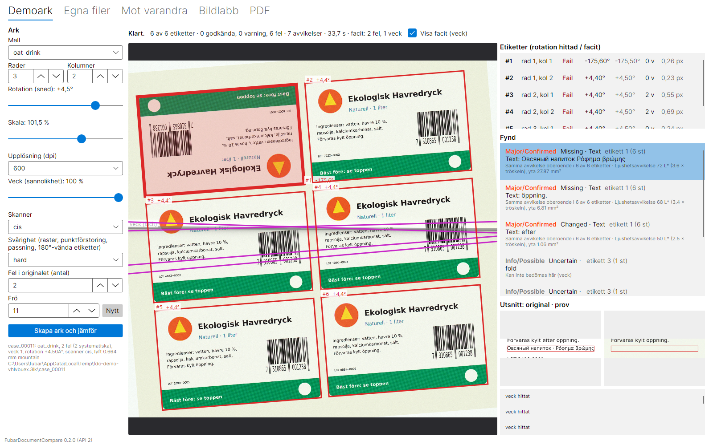
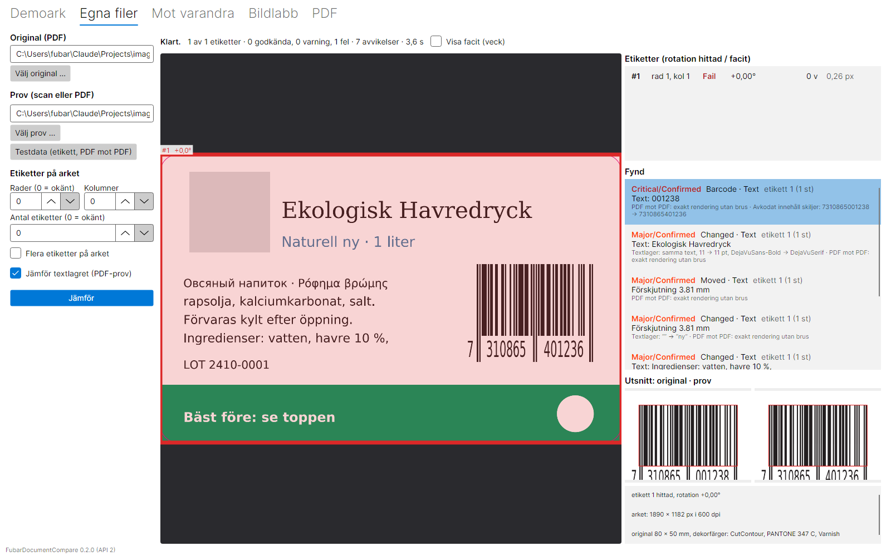
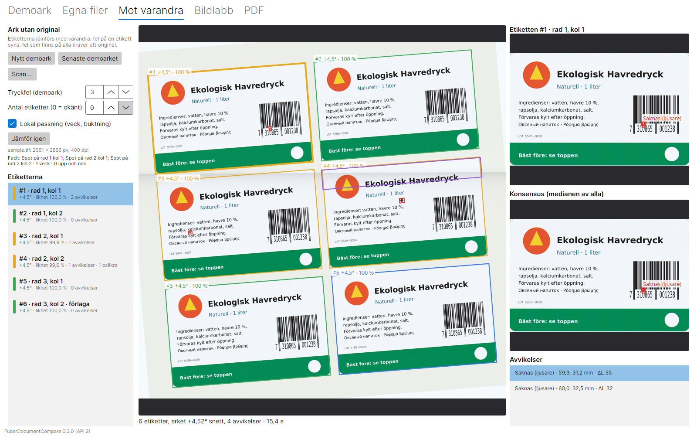
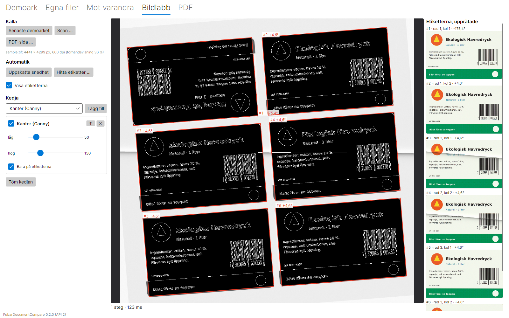
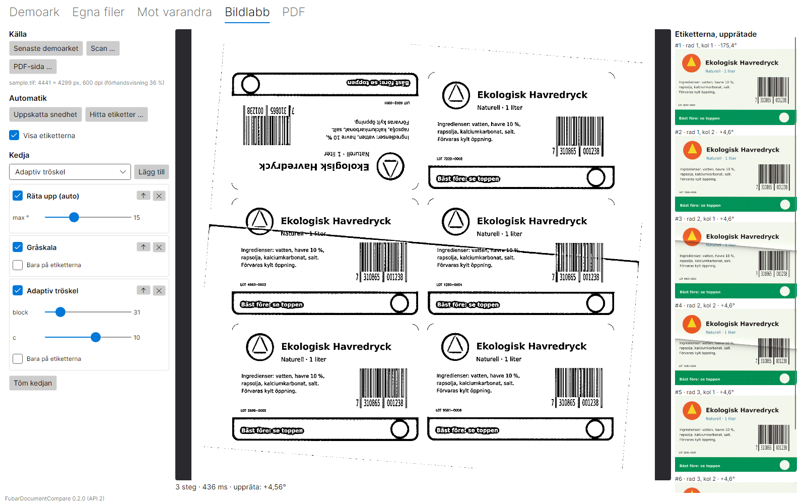
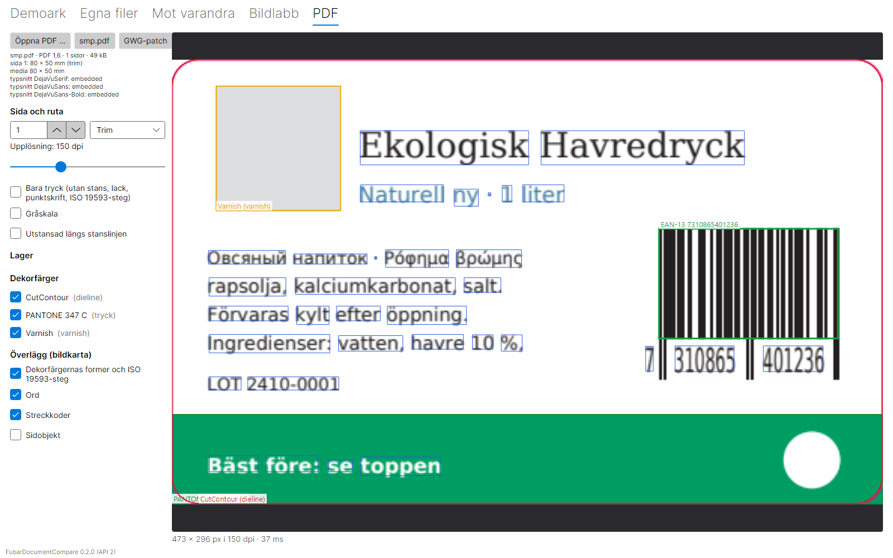
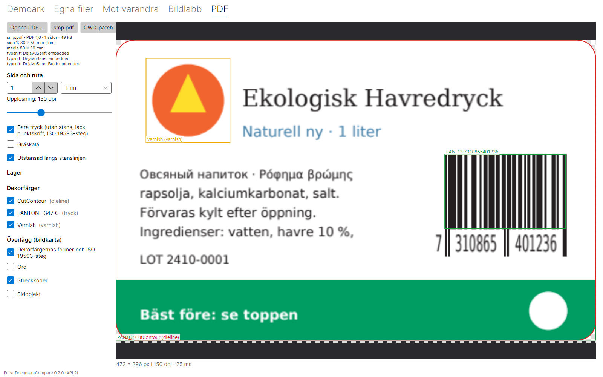

# Demoapp (Avalonia)

En skrivbordsapp som visar det mesta biblioteket kan.

```bash
dotnet run --project demo/FubarDocumentCompare.Demo
```

Avalonia körs på Windows, macOS och Linux. Den inbyggda kärnan (`FubarDocumentCompare.Native` och
`printcmp-testgen`) byggs i dag bara för Windows (`core/build/windows/bin`). På andra system pekar
`FdcNativeDir` ut den egna byggkatalogen.

## Flikar

**Demoark.** Testgeneratorn skapar ett simulerat tryckt och scannat ark, och jämförelsen startar
direkt. Inställningarna:

- etiketter i ett rutnät (rader × kolumner);
- arkets rotation (sned, ±8°) och skala (95–105 %);
- upplösning (300/400/600 dpi);
- veck (sannolikhet);
- skannermodell (äldre, CIS, CCD);
- svårighet: raster, punktförstoring, passning och etiketter vända 180°;
- antal fel i originalet.

Under jämförelsen ritas etiketterna upp när de hittas, med hörn och rotation. Veck ritas när de
hittas, och etiketterna färgas efter status (grön, gul, röd) när de analyserats. Resultatvyn visar:

- etiketterna med hittad rotation jämte facit, antal veck och passningsfel;
- fynden med säkerhetsgrad och skäl;
- utsnitt ur original och prov för det valda fyndet;
- facitets veck (grå) mot de hittade (lila).

**Egna filer.** Ett original (PDF) mot ett scannat ark (TIFF/PNG/JPEG) eller en PDF. Du kan ange
rader, kolumner eller antal etiketter, eller låta dem vara okända. Knappen "Testdata" väljer
etiketten i `testdata/label`.

**Mot varandra.** Ett scannat ark med flera etiketter jämförs utan original: etiketterna hittas mot
bakgrunden, den mest typiska blir förlaga, de andra passas in mot den och var och en jämförs med
medianen av alla (konsensus).

- "Nytt demoark" skapar ett ark med inställningarna under Demoark, utan fel i originalet men med
  tryckfel på enskilda etiketter (antalet väljs här). Facit visas under källan.
- Etiketterna ritas på arket: förlagan blå, övriga gröna, gula eller röda efter antal avvikelser.
  Vridningen (även upp och ned) och likheten med konsensus står vid varje etikett.
- Den valda etiketten (upprätad och inpassad) visas ovanför konsensus, med avvikelserna markerade.
  Veck blir osäkra zoner (lila), inte fel.
- Fel som finns på alla etiketter syns inte utan original; med två etiketter går en skillnad inte
  att tillskriva den ena.

**Bildlabb.** En kedja av filter och transformer med förhandsvisning direkt (lägg till, flytta, slå av
steg och dra i parametrarna). Källan är senaste demoarket, en scan eller en PDF-sida.

- **Uppskatta snedhet** visar vinkeln; steget "Räta upp (auto)" rätar upp.
- **Hitta etiketter** letar mot originalet: hörn och vridning (även upp och ned). Filtersteg kan
  begränsas till etiketterna ("Bara på etiketterna").
- Etiketterna visas utsnidna och upprätade till höger.
- Katalogen: gråskala, gamma, kontrast, CLAHE, oskärpa, median, bilateral, skärpa, egna matriser
  (skärpa, relief, medel), Sobel, gradient, Canny, trösklar, morfologi, låg- och högpass (FFT),
  rasterborttagning, vridning, 90°-steg, spegling och skala.

**PDF.**

- Sida, ruta (trim, media, crop, bleed, art) och upplösning.
- Lager och dekorfärger av och på; ISO 19593-bearbetningssteg visas per lager.
- "Bara tryck", gråskala och utstansning längs stanslinjen (genomskinligt utanför).
- Överlägg: dekorfärgernas former och bearbetningsstegen i rollens färg, ord, streckkoder och sidobjekt.
- Knappen "GWG-patch" öppnar en ISO 19593-patch, om realworld-testet har hämtat dem.

Mushjulet zoomar, dra panorerar och dubbelklick återställer.

## Skärmbilder

```bash
demo/FubarDocumentCompare.Demo/bin/Debug/net8.0/FubarDocumentCompare.Demo --screenshots docs/demo
```

Med argumentet körs demot utan fönster (Avalonia headless med Skia) och sparar en bild per flik:








